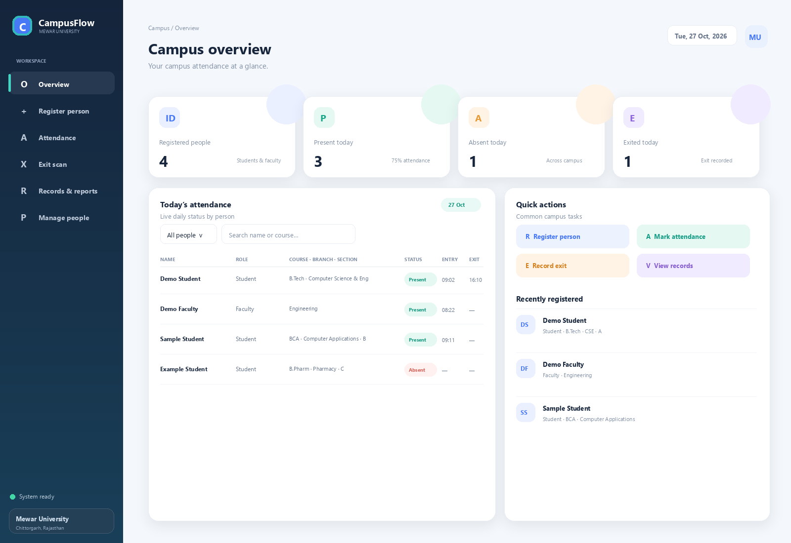
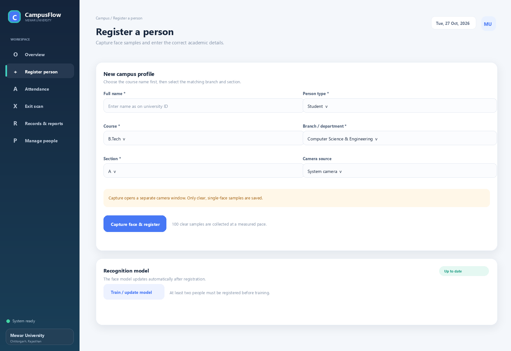
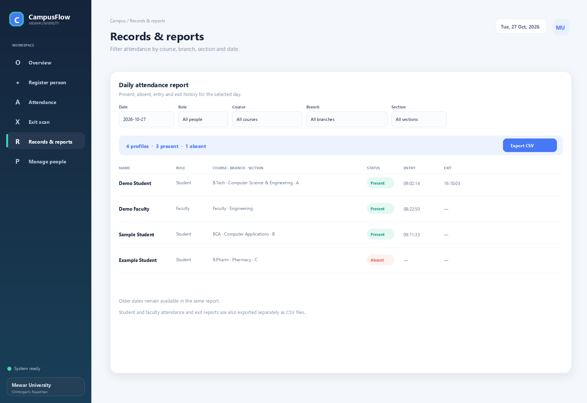

# CampusFlow

CampusFlow is a Windows-first campus attendance app. A local Python process handles the camera, face model and records; the dashboard opens in your browser.

> The images below are illustrative UI previews with fictional sample records. They are not connected to an attendance database and include no face images.

## What it does

- Registers students and faculty with a name, role and course details.
- Captures face samples using a system camera or an IP Webcam phone feed.
- Updates the recognition model automatically after registration. Two active profiles are needed before the model can be trained.
- Marks one attendance entry per person per calendar day and records a separate exit time.
- Shows present and absent records by date, role, course, branch and section.
- Exports student and faculty attendance and exit reports as separate CSV files.
- Moves removed profiles to a Recycle Bin so they can be restored. Permanent deletion removes that profile’s face samples and attendance history.

## Run it on Windows

Use 64-bit Python 3.11 and PowerShell. The first install needs an internet connection to download Python packages. Later runs of the local app do not need internet access.

From the project folder:

~~~powershell
py -3.11 -m venv .venv
.\.venv\Scripts\python.exe -m pip install --upgrade pip
.\.venv\Scripts\python.exe -m pip install -r requirements.txt
.\.venv\Scripts\python.exe src\attendance_app.py
~~~

The dashboard opens at http://127.0.0.1:8765. Keep the Python process running while using it. Close that process to stop the app. Only run one instance at a time; it uses port 8765.

If Windows reports a TensorFlow or DLL import error, follow the Windows CPU setup in the [TensorFlow installation guide](https://www.tensorflow.org/install/pip). Native Windows runs this build on the CPU; TensorFlow GPU support on native Windows ended after version 2.10.

## Connect a camera

### System camera

Choose **System camera** in the registration, attendance or exit screen. Check Windows camera privacy settings if the camera is blocked by another app or by Windows.

### IP Webcam

1. Install and open IP Webcam on the phone, then start its camera server.
2. Connect the phone and computer to the same Wi-Fi network.
3. Use the current address shown by the phone. Enter a base address such as http://192.168.1.25:8080, or the full image address http://192.168.1.25:8080/shot.jpg.
4. Before registering, open the /shot.jpg address in a browser on the computer. It should show a still image. The phone’s IP can change when it reconnects to Wi-Fi.

CampusFlow opens a camera window while connecting and shows the current status. Press **Q** in that window to cancel. If the app cannot read a frame, check the address, phone server and Wi-Fi before retrying.

## Where records are kept

The SQLite database is the source of truth. The app also refreshes CSV exports in the project folder.

- **data/attendance.sqlite3** stores profiles and attendance history.
- **data/faces/** stores the captured face samples for each profile.
- **models/final_model.h5** and **models/labels.json** are generated locally after enough people are registered.
- **student_attendance.csv**, **faculty_attendance.csv**, **student_exit.csv**, **faculty_exit.csv** and **registered_people.csv** are generated reports.

These files are excluded from Git by default. Do not add real faces, attendance records or student details to a public repository. The Recycle Bin protects against accidental profile removal; it is not a backup against a lost drive. For a separate backup, stop CampusFlow and copy the whole data folder to approved secure storage. The face model can be rebuilt from the saved face samples.

## Current limits

This release runs on one Windows computer and stores its records locally. It has no user sign-in or role-based permissions, and the Python server listens only on 127.0.0.1. It is not a hosted or multi-computer university service.

The face model can make mistakes, especially with poor lighting, camera angle or similar-looking faces. A duplicate-face check rejects strong matches to the current model, but it cannot guarantee that every identity is correct. There is no liveness detection. Review attendance before using it for official decisions.

Before a college rollout, the university should review consent and biometric-data handling, access controls, backups, retention and accuracy. See [Privacy and data](docs/PRIVACY_AND_DATA.md) and the [release checklist](docs/RELEASE_CHECKLIST.md).

## Project layout

~~~text
.
├── .github/workflows/       GitHub syntax checks
├── docs/                    Setup, architecture, privacy and release notes
│   └── screenshots/         Fictional-data UI previews
├── models/
│   └── haarcascade_frontalface_default.xml
├── src/
│   ├── attendance_app.py     Main launcher
│   └── campusflow/
│       ├── __init__.py
│       ├── __main__.py       Module entry point
│       ├── app.py            Older Tkinter interface
│       ├── camera.py         Camera inputs and face capture
│       ├── config.py         Local paths and recognition settings
│       ├── recognition.py    Model training and attendance scans
│       ├── storage.py        SQLite records and CSV exports
│       ├── webapp.py         Local HTTP server and app actions
│       └── web/              HTML, CSS and JavaScript dashboard
├── .editorconfig
├── .gitattributes
├── CONTRIBUTING.md
├── SECURITY.md
├── install_autostart.ps1     Optional Windows sign-in startup
├── remove_autostart.ps1
└── requirements.txt
~~~

The supported launch command above opens the browser dashboard. The Tkinter interface in **src/campusflow/app.py** is an older alternative and is not launched by it.

## License

No licence has been selected for this repository. Confirm project ownership and usage rights with the university before adding one or allowing reuse.
